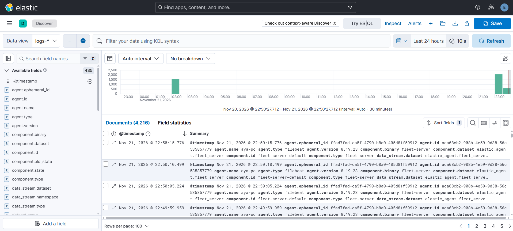
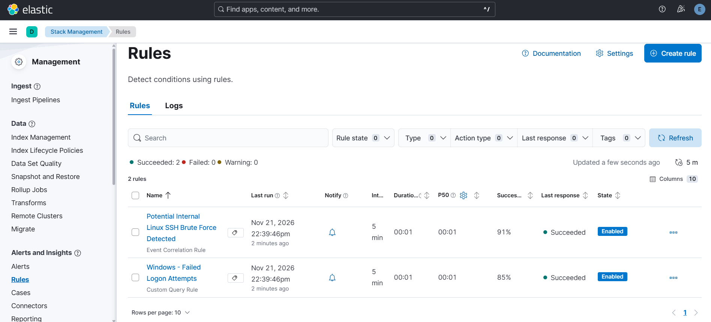
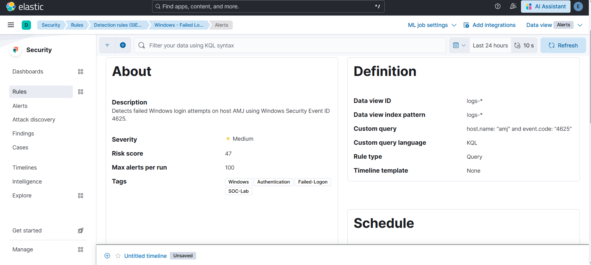
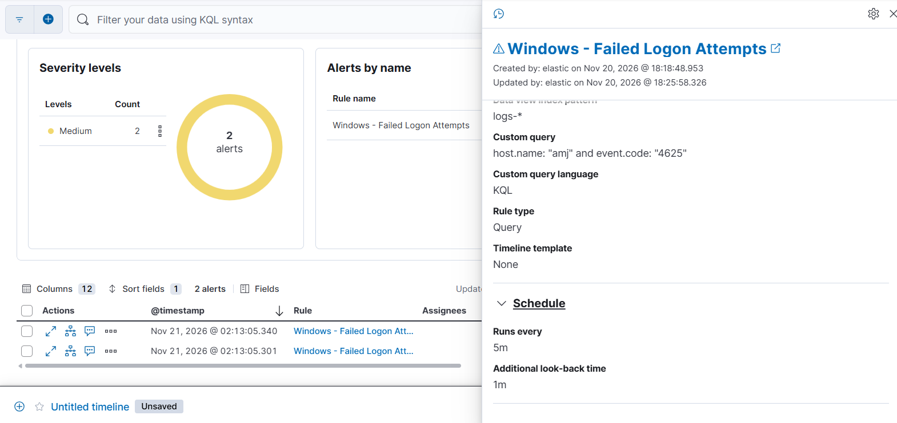
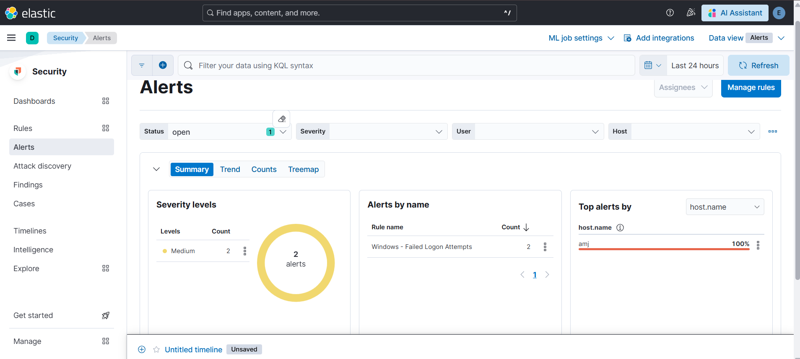
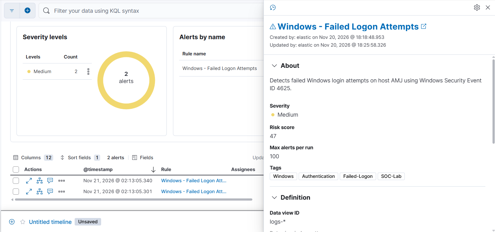
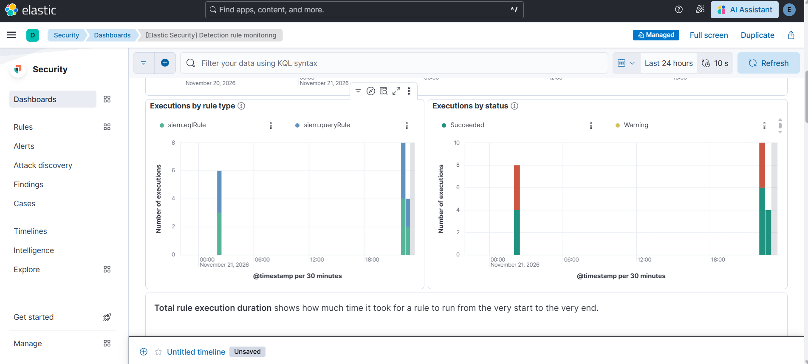

# SOC Home Lab Using Elastic SIEM

# About the Project

This project is a small SOC home lab that I built to practice security monitoring using Elastic SIEM.

I used Ubuntu as the main server and connected a Windows machine to collect and monitor security events. The purpose of this lab was to learn how logs are collected, how suspicious activities can be detected, and how security alerts are investigated.

# Tools Used

- Ubuntu Linux
- Windows 11
- Elasticsearch
- Kibana
- Elastic Agent
- Fleet Server
- Elastic Security

# Lab Setup

I installed Elasticsearch and Kibana on Ubuntu and configured Fleet Server to manage the agents.

After that, I connected my Windows machine using Elastic Agent to send its logs to the Elastic Stack.

I used Kibana to view and search the collected logs.

# What I Did

During this project, I worked on:

- Setting up the Elastic Stack on Ubuntu.
- Connecting a Windows machine to Fleet Server.
- Collecting Windows and Linux logs.
- Monitoring Windows Security events.
- Checking PowerShell and Windows Defender events.
- Searching and analyzing logs using Kibana Discover.
- Creating detection rules to identify suspicious activities.

# Detection Rules

# Windows - Failed Logon Attempts

I created a detection rule to monitor failed Windows login attempts using Event ID 4625.

I tested it by entering an incorrect Windows password and checked the generated alerts in Kibana.

# Potential Internal Linux SSH Brute Force Detected

I also configured a rule to detect potential SSH brute-force activity on Linux.

# Results

The lab successfully collected logs from the connected systems.

I was able to find Windows security events in Kibana and generate alerts for failed login attempts.

I also used Kibana dashboards to view and monitor the collected events.

# What I Learned

Through this project, I gained practical experience in:

- Working with SIEM tools.
- Collecting and monitoring system logs.
- Understanding Windows security events.
- Creating basic detection rules.
- Investigating security alerts.
- Working with Linux and Windows in a monitoring environment.

# Project Purpose

This project was built for learning and practicing basic SOC analyst tasks in a home lab environment
